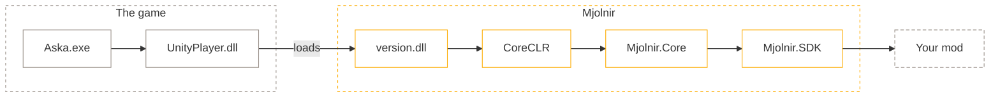

<div align="center">


# Mjolnir

**Mod loader and C# SDK for ASKA**

Write ASKA mods in C# on .NET 10: events, bindable state and builders for UI, players, content and villagers.

[](CHANGELOG.md)
[](https://dotnet.microsoft.com)
[](https://unity.com)
[](LICENSE)

**[Documentation](https://aska-modding-community.github.io/mjolnir-docs/)** ·
[Download](https://github.com/Aska-Modding-Community/Mjolnir/releases/latest) ·
[Install](https://aska-modding-community.github.io/mjolnir-docs/docs/getting-started/installing) ·
[Your first mod](https://aska-modding-community.github.io/mjolnir-docs/docs/getting-started/first-mod) ·
[Coming from BepInEx](https://aska-modding-community.github.io/mjolnir-docs/docs/getting-started/from-bepinex) ·
[Architecture](https://aska-modding-community.github.io/mjolnir-docs/docs/architecture)


</div>

Mods are .NET 10 assemblies that run on CoreCLR inside the game. They reach the game through a high-level SDK of plain
C# events, bindable values and builders, and can still drop to raw HarmonyX patches where they need to.

> **0.x.** The public API can change between minor versions; every change is declared in `PublicAPI.*.txt` and listed
> in [`CHANGELOG.md`](CHANGELOG.md). Everything works in single player and when hosting; the mod-compatibility check
> is tested with a host and a client on two machines.

## A complete mod

```csharp
using Mjolnir.SDK;
using Mjolnir.SDK.Config;
using Mjolnir.SDK.Player;
using Mjolnir.SDK.UI;

[ModManifest("author.lightfoot", "Lightfoot", "1.0.0")]
public sealed class Lightfoot : Mod
{
    public override void OnLoad()
    {
        var cost = Config.Bind("Stamina", "CostMultiplier", 0.5f)
                         .WithRange(0f, 1f);

        LocalPlayer.Stamina.Draining +=
            (_, e) => e.Amount *= cost.Value;

        LocalPlayer.Spawned +=
            (_, _) => Notify.Message("Light on your feet");
    }
}
```

A manifest, a setting and two handlers. The setting shows up in the in-game Mods window as a slider and persists to
TOML. An exception disables this mod alone.

## What a mod can do

| | Module | What it gives |
|---|---|---|
| 🪟 | **[UI](https://aska-modding-community.github.io/mjolnir-docs/docs/guides/ui/overview)** | Windows, HUD and markers, notifications, menu entries and levels, tabs in the game's own settings menu and journal, hotkeys — a control set cloned from the game's own interface |
| 🧍 | **[Player](https://aska-modding-community.github.io/mjolnir-docs/docs/guides/player)** | Spawn and death, health, stamina, food, water and warmth, stamina costs before they are spent, position and teleport |
| 📦 | **[Content](https://aska-modding-community.github.io/mjolnir-docs/docs/guides/content/items-and-recipes)** | Items, weapons, armour and food, recipes by hand and at crafting stations, buildings built in stages, status effects, models from AssetBundles, the item catalog |
| ᛉ | **[Characters](https://aska-modding-community.github.io/mjolnir-docs/docs/guides/characters)** | Attributes and modifiers, skills and experience, status effects — the player and villagers through one sheet |
| ⚔ | **[Combat](https://aska-modding-community.github.io/mjolnir-docs/docs/guides/combat)** | Every blow before it lands (change or cancel it) and after, deaths with their killer, damage and healing dealt by a mod |
| 🏘 | **[Villagers](https://aska-modding-community.github.io/mjolnir-docs/docs/guides/residents)** | The settlement's villagers, jobs of a mod's own they take by priority among the game's tasks, and [interactions](https://aska-modding-community.github.io/mjolnir-docs/docs/guides/interactions) the player and villagers use |
| 🏃 | **[Animations](https://aska-modding-community.github.io/mjolnir-docs/docs/guides/animations)** | The game's clips and a mod's own on the player and villagers: masks, root motion, emotes, moments of a clip, shown to the other players |
| ⛰ | **[Terrain](https://aska-modding-community.github.io/mjolnir-docs/docs/guides/terrain)** | Heights, kinds and biomes of the ground, changes of any shape with snapshots and outlines, the world's trees and stones |
| ☀ | **[World](https://aska-modding-community.github.io/mjolnir-docs/docs/guides/world)** | The world's clock: the hour, day and night, stopping time |
| 🎥 | **[Camera](https://aska-modding-community.github.io/mjolnir-docs/docs/guides/camera)** | Reading the view, modifiers that add up, cameras of a mod's own with blends |
| 🌐 | **[Multiplayer](https://aska-modding-community.github.io/mjolnir-docs/docs/guides/network)** | Message channels between players' mods; every session checks that a joining player's mods match the host's |
| 🔨 | **[Mod kit](https://aska-modding-community.github.io/mjolnir-docs/docs/guides/mod-kit)** | A Unity project for models, animations and masks on the game's own skeletons |

A mod references `Mjolnir.SDK` and only the modules it uses. Beside them, the main library carries the config, the
localization, the main-thread dispatcher and the [developer
console](https://aska-modding-community.github.io/mjolnir-docs/docs/guides/console).

## Why Mjolnir

The same C#, the same Harmony. What changes is the platform under them.

| | A BepInEx plugin | A Mjolnir mod |
|---|---|---|
| **Runtime** | .NET 6 | .NET 10, private, beside the game, with interop generated for your game build |
| **The game's API** | Every plugin patches the game itself | An SDK per area of the game |
| **After a game update** | A renamed game type is fixed in every mod that touched it | The rename is absorbed in the SDK; mods are not touched |
| **A mod that throws** | Every plugin guards itself | Every call into a mod is wrapped: that mod is disabled alone, the game and the others carry on |
| **Multiplayer** | The loader knows nothing about mods | Mods checked between host and client on join, channels between mods, content ids that match on every machine |
| **For the player** | A list and settings come as another plugin | One window in the game: mods on and off, their settings, their text in the player's language |

## Boot chain



1. **version.dll** forwards every real export of the system DLL and detours `il2cpp_init` **by name** — no native
   address is hardcoded. It does nothing outside `Aska.exe`.
2. **CoreCLR**, a private .NET 10 beside the game, starts inside the game's process.
3. **Mjolnir.Core** keeps the interop assemblies for the game's build (generating them at the first start and after a
   game update), starts Il2CppInterop and HarmonyX, then loads mods in dependency order, each in its own load context,
   and isolates their faults. It knows nothing of the SDK or the game's types.
4. **Mjolnir.SDK** is the API mods see: one main library plus a module per area. A rename in the game is fixed here,
   not in every mod.

[Architecture in full →](https://aska-modding-community.github.io/mjolnir-docs/docs/architecture)

## For players

1. Download `Mjolnir-<version>.zip` from the [latest release](https://github.com/Aska-Modding-Community/Mjolnir/releases/latest) and unpack it into the game's
   folder, the one with `Aska.exe`.
2. Start the game from Steam. At the first start, and after each game update, Mjolnir prepares itself for the game's
   build for about half a minute, with a progress window.
3. Put mods into `Mjolnir/Mods/`, each in a folder of its own.

Mods are turned on and off in the game: **main or pause menu → Mjolnir**, from the next start. To start once without
them, launch with `--no-mods` or create a file `Mjolnir/disable`. To uninstall, delete `version.dll`. The log is
`Mjolnir/LogOutput.log`.

[Installing and troubleshooting →](https://aska-modding-community.github.io/mjolnir-docs/docs/getting-started/installing)

## Examples

`examples/` holds complete mods, each showing one area:

| Mod | Shows |
|---|---|
| `Mjolnir.InfiniteStamina` | Config and raw Harmony patches |
| `Mjolnir.UiExample` | Every UI control, a window in MVVM style, menu levels, tabs in the game's windows, localization |
| `Mjolnir.PlayerExample` | HUD bars bound to the player's stats, cheaper stamina |
| `Mjolnir.ItemsExample` | An item with a model of its own, recipes by hand and at a workshop, a building |
| `Mjolnir.EquipmentExample` | Items of a kind: a sword that sets on fire, a hood with armour and an effect while worn, a cake |
| `Mjolnir.StatsExample` | Experience, an effect of the mod's own |
| `Mjolnir.VillagersExample` | A job villagers take: they walk up to the player and greet them |
| `Mjolnir.AltarExample` | A building of its own, built in stages on levelled ground, that the player prays at |
| `Mjolnir.CheatInventory` | The item catalog in a searchable window |
| `Mjolnir.AnimationsExample` | The game's clips on the player and villagers, with a mask and root motion |

## Building from source

Windows with ASKA installed, the .NET 10 SDK, and MSVC x64 with CMake (Visual Studio or Build Tools).

```bash
powershell -File tools/gen-interop.ps1        # once: the interop assemblies the projects compile against
powershell -File tools/deploy.ps1 -Examples   # build and install into the game, with the examples
dotnet test tests/Mjolnir.SDK.Tests           # unit tests: one project per assembly under tests/
powershell -File tools/package.ps1            # the release archive: artifacts/package/Mjolnir-<version>.zip
```

The scripts find the game in your Steam libraries and the Unity 6000.3.12f1 editor in Unity Hub's install folders by
themselves; `-GameDir`, `-Unity` or `MJOLNIR_GAME_DIR` / `MJOLNIR_UNITY` point them elsewhere.

| Path | Contents |
|---|---|
| `src/Mjolnir.Native` | The proxy DLL (C++, CMake) |
| `src/Mjolnir.Core` | The runtime |
| `src/Mjolnir.SDK`, `src/Mjolnir.SDK.*` | The SDK's main library and its modules |
| `tests/` | Unit tests per assembly, and in-game test mods |
| `examples/` | Example mods |
| `tools/` | Build, deploy and packaging scripts, the interop generator, a code map of the game's binary |
| `unity/Mjolnir.ModKit` | The Unity project for mods' AssetBundles |

[Building from source →](https://aska-modding-community.github.io/mjolnir-docs/docs/contributing/building)

## License

MIT, see [`LICENSE`](LICENSE). The third-party components a release ships are listed with their licenses in
`Mjolnir/licenses/THIRD-PARTY-NOTICES.txt` inside the archive. Mjolnir is not affiliated with Sand Sailor Studio.
